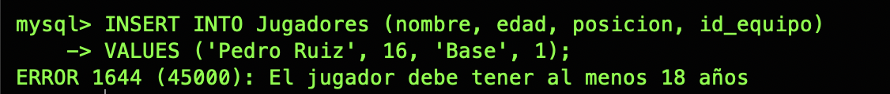

<div align="center">


**La base de datos de una liga de baloncesto: DDL, DML, vistas y triggers en MySQL**


</div>

---

## 🏆 ¿De qué va?

Prácticas del módulo **Gestión de Bases de Datos** de 1º ASIR. Trabajan sobre la base de datos `Baloncesto`, con las tablas **Equipos**, **Jugadores** y **Partidos** y equipos como los *Lions*, *Falcons*, *Tigers*, *Wolves* y *Eagles* 🦁🦅🐯🐺.

| Parte | Tema | Carpeta |
|:-:|---|---|
| 1️⃣ | 16 ejercicios de **DDL y DML** | [`01-ddl-dml`](01-ddl-dml) |
| 2️⃣ | Una **vista** y un **trigger** | [`02-vista-trigger`](02-vista-trigger) |

---

## 1️⃣ DDL y DML: 16 ejercicios

Se crea una tabla nueva de **Entrenadores** y se practican las sentencias SQL más importantes. Cada ejercicio va **comentado con su justificación**.

| # | Qué se hace | Sentencias |
|:-:|---|---|
| 1 | Crear `Entrenadores` con clave foránea y `ON DELETE SET NULL` | `CREATE TABLE` |
| 2–3 | Añadir la columna `salario` con un `CHECK` (sin negativos) | `ALTER TABLE` |
| 4–6 | Crear y eliminar una tabla de prueba, vaciar una tabla | `CREATE`, `DROP`, `TRUNCATE` |
| 7–9 | Insertar entrenadores (uno, varios y un caso con FK inexistente) | `INSERT` |
| 10–12 | Actualizar salarios y borrar un registro concreto | `UPDATE`, `DELETE` |
| 13–15 | Qué pasa con `UPDATE` / `DELETE` **sin WHERE** ⚠️ | `UPDATE`, `DELETE`, `TRUNCATE` |
| 16 | Borrar un equipo con jugadores: **integridad referencial** en acción | `ERROR 1451` |

---

## 2️⃣ Vista y trigger

### 👀 Vista `VistaJugadoresEquipo`

Muestra cada jugador con su posición y su equipo **sin tener que escribir el JOIN cada vez**.

```sql
SELECT jugador, posicion
FROM VistaJugadoresEquipo
WHERE equipo = 'Lions';
```

### 🚫 Trigger `trg_edad_jugador`

Antes de insertar un jugador (`BEFORE INSERT`), comprueba que tenga **al menos 18 años**. Si no, cancela la inserción:

<div align="center">

</div>

### 💡 Mejoras tras la corrección

Después de la corrección de la práctica, añadí dos mejoras:

- 🆔 **La vista incluye los ID** del jugador y del equipo, para poder filtrar y cruzar datos sin depender de los nombres.
- 🔁 **Un trigger `BEFORE UPDATE`**: sin él, se podía dar de alta a un jugador con 20 años y luego cambiarle la edad a 15.

---

## 📂 Contenido del repositorio

```
baloncesto-sql/
├── 01-ddl-dml/
│   ├── practica_baloncesto.sql          # Los 16 ejercicios comentados
│   └── docs/
│       ├── memoria-practica.pdf
│       └── explicacion-ejercicios.pdf   # Explicación comando a comando
└── 02-vista-trigger/
    ├── vista_trigger.sql                # Vista, trigger y mejoras
    ├── docs/memoria-vista-trigger.pdf
    └── img/                             # Capturas de las pruebas
```

## ▶️ Cómo usarlo

Los scripts trabajan sobre la base de datos `Baloncesto`, que ya tiene que existir:

```bash
mysql -u root -p < 01-ddl-dml/practica_baloncesto.sql
mysql -u root -p < 02-vista-trigger/vista_trigger.sql
```

## 💡 Lo que aprendí

- 🔗 Elegir la acción `ON DELETE` adecuada (`CASCADE`, `SET NULL` o `RESTRICT`).
- 🛡️ Proteger los datos con `CHECK`, claves foráneas y **triggers**.
- 👀 Simplificar consultas frecuentes con **vistas**.
- 😱 Por qué un `UPDATE` o `DELETE` sin `WHERE` da tanto miedo.

---

<div align="center">

Hecho con 💜 por [Inma Villaverde](https://github.com/Inma1980)

</div>
